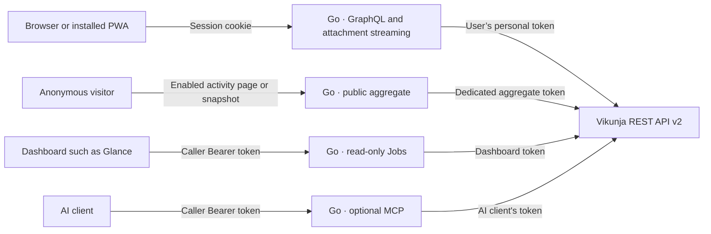

# Architecture and access

This map follows the [Go server wiring](../cmd/server/main.go) in the current
repository. The [personal token contract](specs/personal-token-login.md)
describes browser login, origin selection and migration. Deployment addresses, running
versions and VPN access must be checked on the installation concerned.

## Who can read or change what

| Entry point | Authority in the current application | What to check |
| --- | --- | --- |
| Browser GraphQL | Go validates the personal token and seals it in an expiring browser cookie. Each request runs with the signing user’s token. Mutations require session-bound CSRF protection as applicable. | The origin must match on every GraphQL POST, including login. The personal token needs the permissions for the requested action. [Session and CSRF contract](specs/mvp.md#authentication-and-security) |
| Task attachment streaming | Go verifies the browser session and reads permitted media using that reader’s Vikunja token. | An attachment link requires the reader's session. The response is private. [Discussion media](specs/task-discussion-api.md) |
| Anonymous activity | Each enabled snapshot uses the configured token. Visitors share aggregate counts and the cache, without supplying credentials. | The two feature flags and the canonical origin for search indexing are independent. [ADR-008](decisions/0008-public-activity-http-cache.md) |
| Jobs HTTP API | The dashboard supplies its own read-only Vikunja token. | A returned task link opens Better UI, where the reader signs in separately. [Jobs integration](../README.md#read-only-jobs-integration) |
| Remote MCP | Each client supplies a Vikunja API token. Vikunja checks native MCP access and the permissions for each upstream route. | An enabled endpoint, the right upstream, and the caller's scopes are all required. [MCP transport](specs/mcp-interface.md) |

Vikunja holds tasks, permissions and history. Go embeds the web build and
holds bounded in-process data such as public aggregates and login rate limits.
The browser holds its expiring session and local discussion drafts. See the
[loading decision](decisions/0005-fresh-task-loading.md) and
[discussion contract](specs/task-discussion.md) when changing their lifetime.

## Operating over WireGuard

A phone can open `http://10.77.0.20:8080` over its WireGuard tunnel.
Set `APP_ALLOWED_ORIGIN=http://10.77.0.20:8080` when Docker, a gateway or
a reverse proxy translates the address or port. The setting may be omitted
when the browser opens the private IP and port of Go's actual TCP socket.
Private IPv6 addresses work too, for example `http://[fd00::20]:8080`.
Choose a trusted host for HTTP and keep the full path from the VPN endpoint
to Go on a trusted network.

For TLS termination or a DNS name, set the browser-facing origin explicitly,
for example `https://tasks.example.com`. An explicitly configured canonical
`APP_PUBLIC_URL` can also supply the trusted origin, but opts into indexing.
Leave it empty for a private deployment. Have the proxy accept only the
configured browser-facing authority and restrict who can reach Go directly. Go
ignores forwarded host and scheme headers. [Configuration](../README.md#configuration)

| Symptom | What to check on the affected installation |
| --- | --- |
| A phone cannot open the page | Check its WireGuard route to the destination, the published address and port. For HTTPS, also check certificate trust. |
| The page loads but GraphQL returns “request origin is not allowed” | Compare the browser's scheme, hostname or IP, and port with the configured origin. For DNS, translated ports or ingress, pin the exact external origin without a path or trailing slash. |
| Health succeeds but readiness returns 503 | `GET /healthz` checks the process. `GET /readyz` checks Vikunja API v2 info with a three-second timeout. Check upstream reachability and the supported version. [Probe implementation](../cmd/server/main.go) |
| Glance shows Jobs but tapping one fails | Open the returned `items[].url` from the user's device. The hostname must be reachable there even when Glance calls Go through an internal address. Then check the user's Better UI session. [Jobs response](../internal/integration/jobs_response_types.go) |

## Verification evidence

An ADR records the choice. Source and configuration establish which paths the
application implements. [Quality gates](quality-gates.md) and the
[isolated browser suite](../README.md#development) exercise the release
candidate. A published image identifies an artifact. To establish deployment
behavior, record the image version or digest, date, tested device or client,
expected result and actual result. For VPN access, include a real client opening
the deployed browser address and a dashboard link. Keep tokens, cookies and peer keys out
of the record.
